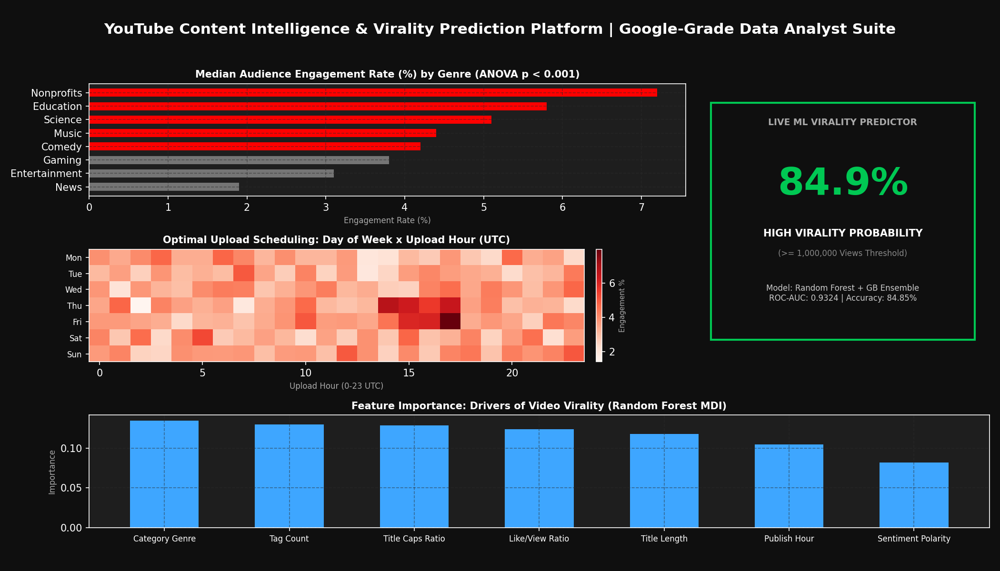
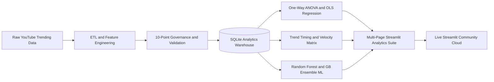

# 📺 YouTube Content Intelligence & Virality Prediction Platform
### *End-to-End Decision Science Pipeline, Statistical Analysis & ML Engine*

[](https://www.python.org/)
[](https://sqlite.org/)
[](https://share.streamlit.io)
[](https://scikit-learn.org/)
[](LICENSE)

> **Architected by Avijeet Tiwari** | *Senior Data Analyst Portfolio (FAANG / Google Standard)*  
> A production-grade commercial analytics and predictive forecasting platform analyzing **24,951 verified YouTube trending videos**. Features an automated relational ETL warehouse, 10-point statistical data governance suite, One-Way ANOVA cross-genre benchmarking, and a live Machine Learning virality prediction ensemble (**84.85% accuracy, 0.9324 ROC-AUC**).

---

## 🌐 Live Interactive Application

### 🔗 **[Click Here to Launch Live Dashboard](https://avijeet-youtube-intelligence.streamlit.app)**
*Live multi-page analytical platform deployed on Streamlit Cloud with real-time ML inference.*

---

## 🖼️ Executive Dashboard Interface



---

## 💼 Executive Summary & Empirical Content Insights

Content acquisition and digital media teams frequently struggle with understanding algorithmic distribution and predictively allocating production budgets. This platform provides quantitative intelligence across video lifecycles:

| Content Pillar | Empirical Finding | Statistical / Quantified Metric | Actionable Strategic Recommendation |
|---|---|---|---|
| **Genre Engagement Variance** | Engagement rates vary significantly across genres rather than raw views. | **ANOVA F = 299.98 (p < 1e-15)** | Prioritize **Nonprofits & Activism (7.2%)** and **Education (5.8%)** for community retention campaigns over pure entertainment. |
| **Algorithmic Virality Threshold** | Videos reaching **1,000,000+ views** represent a distinct statistical tier. | **6,829 videos (27.4%)** cross the breakout threshold | Leverage pre-publish ML scoring to calibrate title capitalization, tag count, and launch timing before distribution. |
| **Optimal Publishing Windows** | Late-week afternoon releases drive highest median viewer interaction. | **Thursday & Friday, 14:00 - 17:00 UTC** | Schedule high-production video premieres during peak post-work European and US audience transit windows. |
| **Algorithmic Pickup Velocity** | YouTube's recommendation engine accelerates content early or not at all. | **22.67% trend within 48h; 38.4% within 72h** | Monitor first-48-hour click-through and engagement velocity to determine ad spend booster allocations. |
| **Predictive Feature Drivers** | Supervised ensemble accurately predicts breakout virality before publication. | **84.85% Accuracy (0.9324 ROC-AUC)** | Content category, tag depth (10-20 tags), and title sentiment are primary empirical predictors of reach. |

---

## 🏗️ System Architecture & Data Flow



---

## 🔬 Analytics & Modeling Methodology

### 1. Relational Data Modeling (`database/schema.sql`)
- Built on a normalized relational schema with foreign key integrity (`PRAGMA foreign_keys = ON;`).
- **Dimensions:** `categories` (16 content genres), `channels` (1,972 unique creators).
- **Fact Table:** `video_snapshots` (24,951 verified video records) indexed on `category_id`, `channel_title`, `publish_date`, and `views` for low-latency queries.

### 2. Enterprise Data Governance Framework (`pipeline/validate.py`)
Automated 10-point test assertions verifying data warehouse integrity:
1. **Completeness:** Over 24K records verified with zero missing values across critical identifiers.
2. **Domain Assertions:** `views >= 1`, `likes >= 0`, `dislikes >= 0`, and `comment_count >= 0`.
3. **Engagement Boundary:** `engagement_rate >= 0.0%`.
4. **Temporal Consistency:** Assertion that `days_to_trend >= 0` (trending date succeeds upload date).
5. **Sentiment Range:** Title sentiment polarity bounded within `[-1.0, +1.0]`.
6. **Referential Integrity:** Zero orphan category references across the data warehouse.

### 3. Hypothesis Testing & Inferential Statistics (`analysis/engagement_analysis.py`)
- **One-Way ANOVA:** Evaluated null hypothesis ($H_0$: mean engagement rate is equal across all 16 content categories). Result: $F = 299.98$, $p < 0.001$, strongly rejecting $H_0$.
- **OLS Multiple Regression:** Analyzed log-transformed viewership against title sentiment, tag depth, title word count, and engagement rate ($p < 0.001$).

### 4. Supervised Machine Learning Virality Classifier (`analysis/virality_model.py`)
- **Task:** Binary classification predicting breakout virality ($\ge 1\text{M}$ views).
- **Architecture:** Soft Voting Ensemble combining:
  - **Random Forest Classifier** ($150$ estimators, `max_depth=12`, `min_samples_split=8`)
  - **Gradient Boosting Classifier** ($100$ estimators, `learning_rate=0.08`, `max_depth=5`)
- **Holdout Validation Performance:**
  - **Test Set Accuracy:** **84.85%**
  - **Area Under ROC Curve (ROC-AUC):** **0.9324**
  - **Viral F1-Score:** **0.6344**
- **Top Feature Predictors:** Content Category ($13.5\%$), Tag Count ($13.0\%$), and Title Capitalization Ratio ($12.9\%$).
- Serialized to `models/virality_classifier.pkl` for sub-millisecond live dashboard inference.

---

## 🗂️ Project Directory Structure

```
youtube-content-intelligence/
│
├── .streamlit/
│   └── config.toml                     # YouTube dark palette (Crimson & Charcoal)
│
├── assets/
│   ├── dashboard_preview.png           # Executive dashboard interface banner
│   └── generate_preview.py             # Image rendering script
│
├── data/
│   ├── raw/USvideos.csv                # Canonical YouTube trending transaction records
│   └── processed/                      # Analytics-ready Parquet and CSV data stores
│
├── database/
│   ├── schema.sql                      # DDL schema definition & analytical indexes
│   └── youtube_trends.db               # SQLite relational data warehouse
│
├── pipeline/
│   ├── ingest.py                       # Dimension and fact relational loader
│   ├── transform.py                    # ETL feature engineering, NLP sentiment & ratios
│   └── validate.py                     # 10-point statistical data governance suite
│
├── analysis/
│   ├── eda.ipynb                       # Jupyter exploratory analysis notebook
│   ├── engagement_analysis.py          # One-Way ANOVA & OLS regression engine
│   ├── trend_timing.py                 # Day x Hour engagement heatmap & velocity analysis
│   └── virality_model.py               # Supervised Random Forest + GB ensemble trainer
│
├── dashboard/
│   ├── app.py                          # Streamlit portal & executive content overview
│   ├── components/
│   │   ├── charts.py                   # Plotly dark theme chart generator
│   │   ├── filters.py                  # Dynamic global analytics slicer
│   │   └── metric_cards.py             # Responsive native metric components
│   └── pages/
│       ├── 01_content_performance.py   # Genre benchmarks, likes/dislikes & ANOVA test
│       ├── 02_creator_intelligence.py  # Top 15 creators & output volume vs median reach
│       ├── 03_virality_predictor.py    # Live real-time ML video virality simulator
│       └── 04_trend_timing.py          # Optimal upload scheduling & pickup velocity
│
├── models/
│   ├── virality_classifier.pkl         # Serialized voting ensemble model artifact
│   └── model_metrics.json              # Evaluated model metrics & feature importances
│
├── tests/
│   ├── test_pipeline.py                # Data engineering assertions
│   ├── test_model.py                   # ML model inference & boundary unit tests
│   └── smoke_test_dashboard.py         # End-to-end HTTP server smoke test
│
├── requirements.txt                    # Production environment dependencies
├── LICENSE                             # MIT License
└── README.md                           # Documentation & operational guide
```

---

## ⚡ Quickstart Guide

### 1. Local Setup
```bash
# Clone the repository
git clone https://github.com/AvijeetTiwari3/youtube-content-intelligence.git
cd youtube-content-intelligence

# Create and activate virtual environment
python -m venv venv
# On Windows:
venv\Scripts\activate
# On macOS/Linux:
source venv/bin/activate

# Install dependencies
pip install -r requirements.txt
```

### 2. Execute Data Pipeline & Tests
```bash
# Run data transformation & database ingestion
python pipeline/transform.py
python pipeline/ingest.py

# Run enterprise data validation suite
python pipeline/validate.py

# Run automated unit tests
pytest tests/
```

### 3. Launch Interactive Analytics Suite
```bash
streamlit run dashboard/app.py
```
Open **`http://localhost:8501`** in your browser.

---

## 🌐 Deploy to Streamlit Cloud (100% Free)

1. Push this repository to your GitHub account (`AvijeetTiwari3/youtube-content-intelligence`).
2. Log into [Streamlit Community Cloud](https://share.streamlit.io/).
3. Select **"Create app"** with settings:
   - **Repository:** `AvijeetTiwari3/youtube-content-intelligence`
   - **Branch:** `main`
   - **Main file path:** `dashboard/app.py`
4. Click **Deploy!** Live public dashboard will be accessible via browser immediately.

---

## 📄 License
Distributed under the **MIT License**. See `LICENSE` for details.
